# An Nam Golden

Họ chữ phát triển từ AnNam Serif (designer 19–20/11). Dựng bằng luật trên outline Regular + Bold của AnNam Serif
(`tools/construct/golden/golden.py`), Medium / SemiBold nội suy; chạy `bash tools/construct/golden/run.sh` sau pipeline AnNam Serif.
Font: `fonts/golden/` (OTF, TTF, variable, woff2), tên họ "AnNam Golden", PostScript `AnNamGolden-*`.

| Luật | Nội dung |
|---|---|
| G1 | x-height 495 → 535 (chữ thường, chữ ghép, dấu tổ hợp); bề ngang giữ; đầu thân b d h k l þ giữ 699 (chỉ đoạn thân thẳng co), đ thanh giữ dày, f móc giữ hình (cao thêm 20), ß phần trên co; dấu, chấm dời lên 40.7 |
| G5 | đầu t (và t trong ft tf tt) vát: mép phải thân thẳng lên đỉnh cao 1.03 × bề ngang thân trên mặt thanh, cạnh vát xuống mặt thanh cách mép trái thân 0.625 × phần thanh thò trái (hình phác designer) |
| G4 | v x y (ý ỳ ỷ ỹ ỵ ÿ) rộng × 1.08 quanh tâm, nét thu lại × 1/1.08 (giữ bề dày), dấu giữ hình |
| G3 | loe (chân, đỉnh thân, chéo): rộng × 1.3 theo đường chân, cao × 0.85 — vuốt nhọn; điểm nối thân trượt trên đường thân (liền tiếp tuyến) |
| G2 | nét mảnh (thanh ngang, chéo mảnh, vòng mảnh, khớp) chữ hoa + thường còn ~80 %: mép dời theo pháp tuyến 0.1 × bề dày; đoạn thẳng đo ở giữa đoạn (thanh không vát); cung dài chia đôi để đặt luật tại chỗ mảnh nhất; thân dày, dấu giữ |

Số đo (Regular, trục giữa): thanh H 40 → 32, N đứng 48 → 36, O mảnh 34 → 27, S mảnh 38 → 29; thân giữ 104.
Ảnh: `docs/img/golden-v1.png`.

## S50 — luật nét mảnh làm lại (20/11)

- Đoạn thẳng: dời song song cả đoạn; góc cung–thẳng chỉ theo phía đoạn thẳng; đoạn ngắn nối tiếp nét thẳng (≤ 20°) dời cùng nét (W giữ góc nối gốc).
- G7 s S: lòng trên / dưới kéo dãn đứng affine từ điểm chân chuỗi (không đẩy từng điểm neo → hết gãy góc).
- G10 (mới) mọi nét mảnh cong còn lại — b d p q a g c C G U J, vòm n m h u, B D P R: chuỗi cung lõm của mép lòng kéo dãn đứng, dốc tuyến tính từ giữa chuỗi (affine, tay nắm cùng phép); góc trên thân đứng trượt theo thân (cả tay nắm kề), góc khác đứng yên. δ = min((dày − chuẩn)/dốc) đo theo pháp tuyến → không điểm nào mỏng hơn chuẩn. Lòng kín: hai chiều (làm dày được); lòng hở: chỉ kéo mảnh (đầu nét / vai mảnh là chủ ý).
- Bỏ đoạn < 2 u ở cả hai master (nách K).
- Đo: Golden 32 / 44 ± 2 (trừ B D R ~40 / 52–55 — mép thẳng trên đường kẻ); AnNam Serif 42 / 62 (n m h u C G 37–38 Regular theo bản vẽ, lòng hở không làm dày).

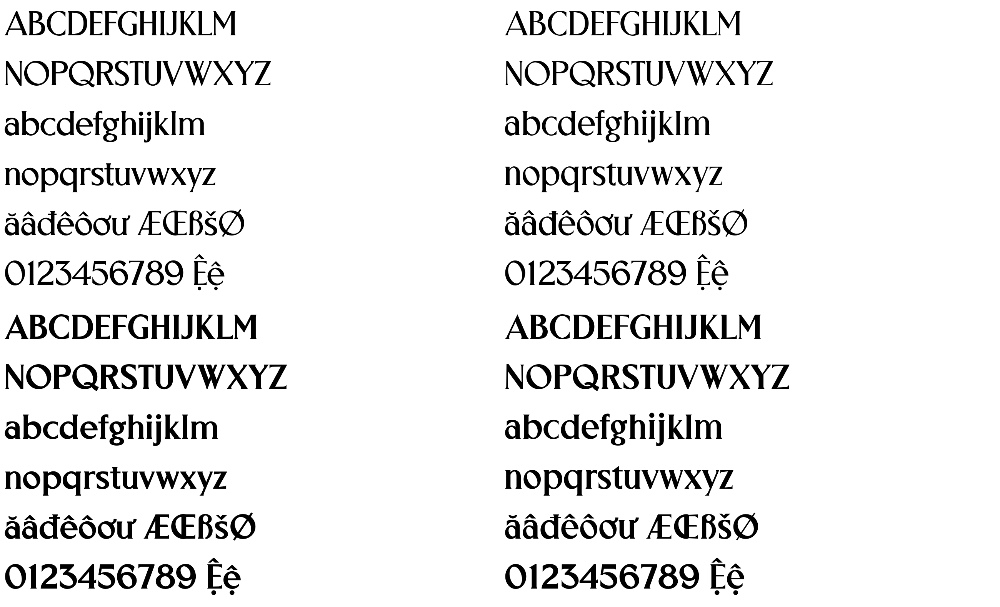

## S51 — thanh ngang không dốc (designer 20/11 "nét trong của Z bị dốc", "kiểm tra z luôn")

Nguyên nhân (cả AnNam Serif lẫn Golden): (1) góc cung–thẳng (đầu thanh nối loe) giải theo tiếp tuyến cung → gần như đứng yên trong khi đầu nối thân dời; (2) khi làm DÀY (hệ số > 1) điều kiện chặn độ dời dùng max(da, db) = 0 → góc nối thân bị bỏ; (3) góc thẳng–thẳng trên đường kẻ (đỉnh chéo M W Y K) bị bỏ qua thay vì trượt dọc đường kẻ; (4) mẩu nối 2.5 u ở nách K không có tiếp tuyến.
Sửa: góc cung–thẳng dời theo pháp tuyến đoạn thẳng; chặn theo |da|, |db|; góc thẳng–thẳng trên đường kẻ trượt dọc đường kẻ; bỏ mẩu < 3 u trước mọi luật.
QA mới `tools/construct/qa_lines.py` (chạy cuối pipeline, so với v0.918): đoạn ngang / đứng giữ hướng (≤ 0.3°), mép trên đường kẻ còn trên đường kẻ, AnNam Serif mọi đoạn giữ hướng (≤ 0.5° + sai số làm tròn). Kết quả: Golden 0 · AnNam Serif 1 (Ë Bold — chủ ý: Ë = E + dấu thay cho Ë vẽ riêng ở v0.918).

## S52 — thanh T và đồng bộ mọi thanh (designer 20/11 "thanh ngang của T sao lại dày hơn của các chữ khác")

- G11 thanh T: thanh là contour riêng chồng thân, mép dưới là hai cung loe chạy vào thân → điểm nối cung–thân (tiếp tuyến ngang) dời đứng tới đúng chuẩn; đầu nhọn loe đứng yên.
- G8 tuyệt đối: mỗi đoạn thẳng nét mảnh (0.5–1.6 × chuẩn) tự về ĐÚNG chuẩn, đo riêng giữa đoạn (bỏ hệ số chung cả chữ — làm thanh P mảnh quá). Áp mọi chữ gốc, gồm thanh e f t.
- QA mới `tools/construct/qa_bars.py`: độ dày thanh ngang mọi chữ so chuẩn (lệch > 3 u = lỗi). Kết quả: AnNam Serif 42 / 62 ± 1, Golden 32 / 44 ± 1, 0 lỗi.

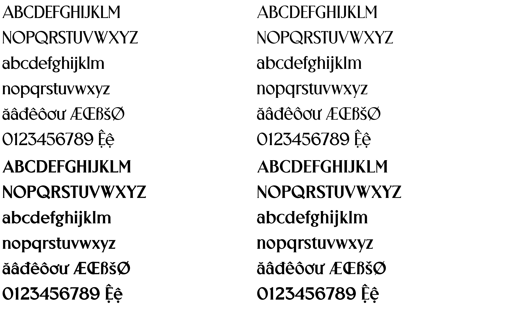

## S54 — weight AnNam Serif đồng bộ theo Golden (designer 20/11 "đồng bộ weight của serif giống với golden")

Golden giữ tương phản cố định qua các weight (nét mảnh / thân = 32/104 = 44/140 ≈ 0.31). AnNam Serif trước đây 42 → 62 (0.40 → 0.44: Bold mất tương phản, nặng). Nay nét mảnh AnNam Serif tăng đúng theo thân: Regular 42, Bold 56.5 (= 42 × 140/104), Medium / SemiBold nội suy (46.8 / 51.7) — tương phản 0.40 cố định.
Kèm: đoạn thẳng gần thẳng hàng (≤ 6°) với đoạn kề dài hơn (mép nét bị chia bởi khớp / mẩu nối, vd. chéo mảnh W, tay K) dời cùng nét đó.
QA: thanh ngang AnNam Serif 42–43 / 56–58, Golden 32–33 / 41–45, 0 lỗi; đoạn thẳng đổi hướng Golden 0, AnNam Serif 2 (x Regular 0.52°, K Bold 0.67° — ≤ 3 u trên cả đoạn); 0 lỗi outline; đơn điệu 4 weight AnNam Serif 0 lỗi.

## S55–S56 — nét ngang Golden 0.88, loe chữ hoa dài hơn, tay loe bằng nhau (20/11)

- Golden: nét NGANG = 0.88 × nét mảnh (designer chọn k 0.88 — "nét ngang F L T E Z dầy hơn nét còn lại": hiệu chỉnh quang học, nét ngang trông dày hơn nét cong cùng số đo). Regular 28 / Bold 39.
- Golden: loe chân chữ hoa rộng × 1.45 (chữ thường giữ × 1.3) — "đuôi chân loe dài thêm ra thêm xíu".
- G13 tay loe đầu thanh (mép cắt đứng ở đầu tay E F L T Z Æ Œ) dài BẰNG NHAU: AnNam Serif 94 / 122 (bản vẽ gốc), Golden 114 / 148. Trước đó T và E lệch tới 34 u (Bold).
- Mép thẳng trên đường kẻ: dung sai 2.5 u (phần E của Œ nối từ điểm vượt O, xiên 2 u — trước bị dời lên 4 u, rời chân / đỉnh).
- QA mới `qa_arms.py` (độ dài tay loe bằng nhau). Kết quả: cả hai họ chênh 0.0 ở 4 weight; thanh ngang 0 lỗi; đoạn thẳng Golden 0.
- Version 0.920.

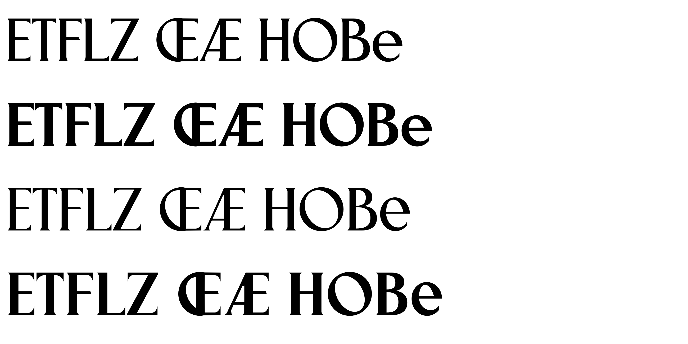

## S57 — đỉnh A của Æ, chân l Golden (20/11)

- Æ: đoạn ngắn ở đỉnh trong A (thẳng hàng với mép trong nét chéo, 65.9°) bị xoay thành 14.5° (Bold) → gãy. Nguyên nhân: hướng ra ngoài của đoạn thẳng thử ở điểm 3 u sát góc — góc hẹp nên điểm thử lọt vào thân E bên cạnh, pháp tuyến đảo, điểm nối trượt XUỐNG 28 u thay vì lên. Sửa: đoạn thẳng thử ở GIỮA đoạn. Nay 65.2° / 64.3°.
- G14 (chỉ Golden, designer "dùng chân chữ t cho chân chữ l"): l = loe đỉnh của l + thân dưới và móc chân của t (cùng bề thân, dời ngang trùng mép trái).
- Rà từng cờ đổi chiều cong: A e Æ ø — cung phẳng, không gợn; W — gợn ~1 u ở cung loe đầu chéo mảnh (chỉ thấy khi phóng 30×). Version 0.921.

## S58 — W hết gợn, thanh t Golden đều hai bên, Ø (20/11)

- Chuỗi cung nằm giữa hai góc (cung loe đầu chéo mảnh W…): độ dời mọi điểm nội suy tuyến tính giữa hai góc; tay nắm kề góc đi cùng góc (giữ tiếp tuyến); nếu một đầu đứng yên mà kề đoạn thẳng thì trượt dọc đoạn đó theo hình chiếu độ dời (loe đi theo nét — cả chuỗi gần như tịnh tiến). Trước: chỉ lan một phần qua bước làm trơn → gợn ~1 u, Golden uốn chữ S.
- G15 (Golden) thanh t: mép dưới phần thanh bên trái thân (mép trên là nét chéo đầu t — G8 không làm mảnh được) đặt bằng mép dưới bên phải → hai bên cùng 28 / 40 (cả ft tf tt).
- Ø ø spacing theo O o (Ø = O + nét gạch): advance tăng đều 4 weight.
- Rà toàn bộ: Golden 0 cờ độ cong / gãy; AnNam Serif chỉ W 3.7° (có sẵn ở bản vẽ gốc). Version 0.922.

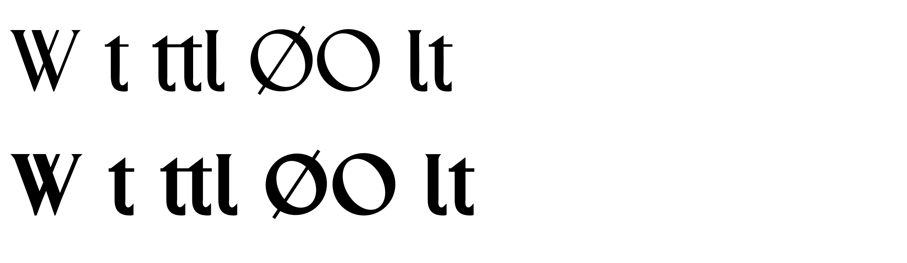

## S59 — nét mảnh Golden = AnNam Serif (20/11, "nét xéo của golden mỏng quá" → "các nét mỏng của Golden đưa về bằng với nét mỏng của Serif")

- RING_T / ARCH_T Golden 32 / 44 → 42 / 56.5 (= AnNam Serif); bỏ bước làm mảnh theo tỉ lệ (THIN_R 0.8 / 0.65 → 1.0). Nét ngang giữ 0.88 × (37 / 50).
- Sửa lỗi: G3b (loe đầu tay ×1.4, chỉ dành cho tay chữ hoa) áp nhầm cho đầu cờ x-height của m n h r … — kéo dài đầu cờ và làm mảnh vai vòm (m 31). Nay chỉ chữ hoa.
- Đo: Golden 41–42 / 56 (m n u Bold 56–63 theo bản vẽ), thanh 37–38 / 50–51; 0 cờ độ cong / gãy mới. Version 0.923.

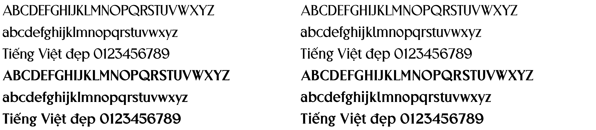

## S60 — spacing Golden theo AnNam Serif (20/11, "kerning của Golden bị rộng hơn so với serif?")

Kerning hai họ gần như nhau; chỗ khác là sidebearing: spacing lấy H / n làm chuẩn khoảng trắng — loe Golden to hơn làm H "thoáng" hơn → chuẩn tăng → mọi chữ tròn / chéo nới 5–8 u mỗi bên (o 33 vs 28, O 39 vs 31, A V 28 vs 20). Nay Golden đo chuẩn khoảng trắng trên H / n của AnNam Serif (DIZAI_TREF): chữ tròn / chéo = AnNam Serif; H n Golden khít 8 u để bù loe. Version 0.924.

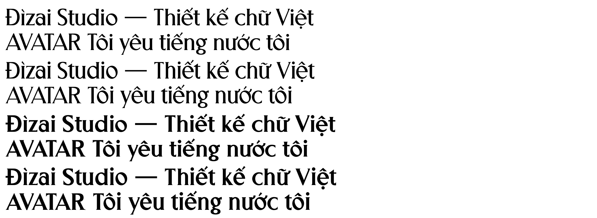

## S61 — chữ hoa Golden dày y như AnNam Serif (20/11, "Golden hoa nên có độ dày y chang Serif. khác loe chân")

CAPS_AS_SERIF: chữ HOA Golden bỏ mọi bước nét mảnh riêng (G7 G9 G6 G10 G11 G8, nét ngang 0.88) — giữ đúng độ dày AnNam Serif; chỉ khác loe chân (× 1.45, giữ như cũ — thử × 2.9 bỏ) và tay loe đầu thanh (G13, 114 / 148). Diện tích mực chữ hoa Golden / Serif = 1.000–1.012 (phần chênh = loe). Chữ thường Golden giữ nguyên (nét ngang 0.88). Version 0.925.

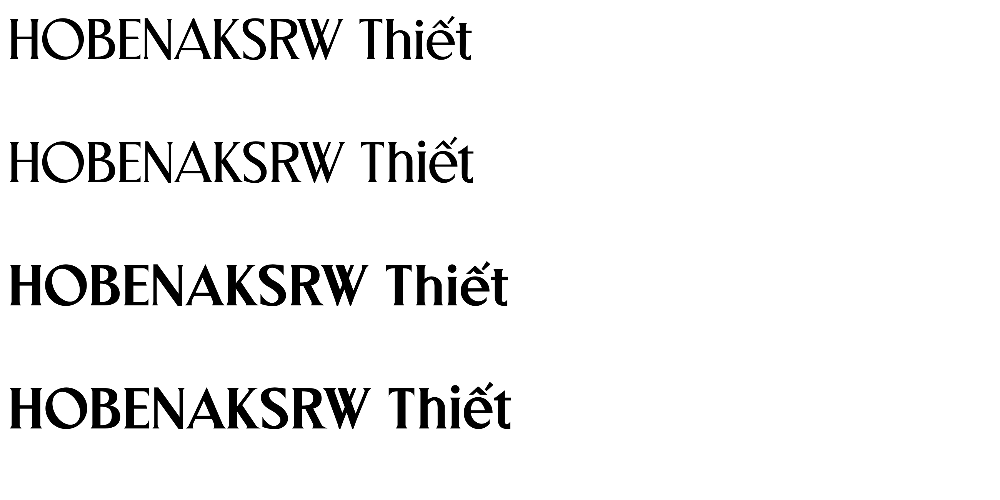

## S62 — chân chéo K R không gãy khúc (21/11, "K hoa chân bị lỗi")

G3 phóng loe: phía thân phóng dọc thân, phía chân trước đây phóng theo trục x–y → thân CHÉO (K R) hai nửa cung loe biến đổi khác nhau → cung gãy khúc. Nay phía chân phóng theo hệ trục (dọc chân, dọc thân) — một phép phóng chung cho cả cung. Version 0.926.

## S63 — AnNam Serif variable gộp Golden: trục x-Height (21/11, "gộp 2 cái thành variable … Dùng An Nam Serif. Trục x-Height … kéo mượt")

- `tools/construct/xhgt_var.py` (chạy cuối golden/run.sh): `AnNamSerif[XHGT,wght].ttf` + `AnNamSerif-Italic[XHGT,wght].ttf` (+ woff2). Trục wght 400–700 · XHGT "x-Height" 495 (AnNam Serif) → 535 (AnNam Golden), nội suy mượt (x-height, loe, nét mảnh, spacing, kerning). 4 master (Serif / Golden × Regular / Bold); 8 kiểu đặt tên: Regular … Bold, Golden Regular … Golden Bold. STAT: wght, XHGT (Serif / Golden), ital.
- Chữ khác cấu trúc (đầu t Golden): t, t_f, t_t → `.gold` qua rvrn/rclt khi XHGT ≥ 515 (thay SAU chữ ghép).
- Designer "chân chữ l và t đưa về cùng chiều như golden cho serif": G14 áp cho AnNam Serif (hair_sync) — l mang chân móc t ở cả hai họ → l tương thích, không cần chữ thay.
- Bản AnNam Golden riêng giữ nguyên ("bản golden vẫn giữ nhé"). Version 0.928.

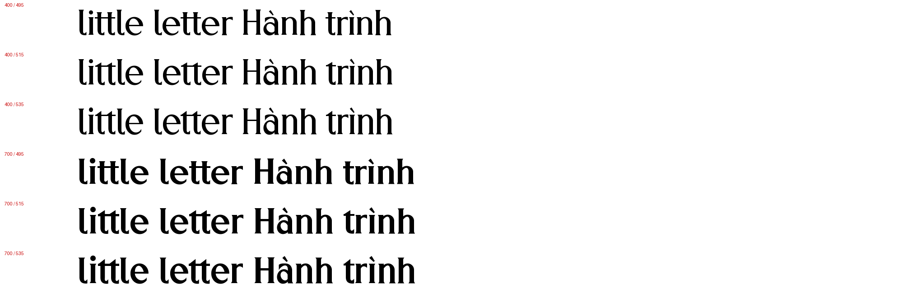

## S64 — một file chung đủ ba trục (21/11, "dựng chung 1 bản cho serif")

`AnNamSerif[XHGT,slnt,wght].ttf` (+ woff2): wght 400–700 · XHGT 495–535 · slnt 0 … −10°, 8 master (Serif / Golden × R / B × đứng / nghiêng), 16 kiểu đặt tên; t / t_f / t_t → dạng Golden khi XHGT ≥ 515. Trang duyệt AnNam Serif: mục Font variable dùng file này — đủ ba thanh kéo. Version 0.929.

## S65 — trục x-Height kéo được trong Figma (21/11, "trục xheight không hoạt động trong Figma" → "thanh trục vẫn còn chỉ là k kéo được")

- File ba trục đổi tên họ riêng **"AnNam Serif VF"** → `AnNamSerifVF[XHGT,slnt,wght].ttf` (PS `AnNamSerifVF-…`). Trước đây trùng họ "AnNam Serif" với bản tĩnh và bản chỉ có wght → Figma gộp họ, có thể lấy nhầm file.
- Thang trục XHGT đổi từ 495–535 sang **0–100** (cả ba file có x-Height): 0 = AnNam Serif (x-height 495), 100 = AnNam Golden (x-height 535), tuyến tính (x = 495 + 0.4 × XHGT); t / t_f / t_t đổi dạng Golden từ 50. Trục tự đặt có min = mặc định = 495 thì Figma hiện thanh nhưng không kéo được; thang 0–100 mặc định 0 như các trục tự đặt phổ biến.
- Outline, advance không đổi: so 5994 glyph × (wght 400/550/700 × đứng/nghiêng × XHGT 495↔0, 515↔50, 535↔100) với bản 0.929 — 0 khác.
- Version 0.930.

## S66 — móc trên a trơn (21/11, "Bụng móc trên của a cả serif và golden không smooth")

Bản vẽ thân a (`D_A_STEM`, lower/src_lower.py) có ba chỗ không trơn; mọi weight, Golden, a có dấu đều dựng từ đây:
- vai ngoài: tay nắm suy biến (cp2 trùng điểm cuối ở thân) → độ cong vọt sát thân (lược: gai);
- đỉnh trái gần thẳng → độ cong nhảy ở đỉnh (font: 2.9 → 0.4);
- lòng móc: hai cực độ cong, giữa phẳng → u gồ gần đầu cắt.

Luật: giữ MỌI điểm neo và hướng tiếp tuyến, chọn lại độ dài tay nắm (tối thiểu ∫(dκ/ds)², khớp G2 ở đỉnh, lệch bản vẽ ≤ 1 px ≈ 2.8 u) — như vai n (D_N_ARCH, 05/11). Lòng móc xoay hướng ở đầu cắt 3° (góc mũi 23.7° → 26.7°) để độ cong giảm dần về đầu cắt. Bold: lòng móc dày xuống theo B_BAR như cũ (tay nắm mới, `A_HOOK_CP`). Bản cũ giữ ở `D_A_STEM_PRE_S66`.

Font (Regular, độ cong ×1000): vai 0 → 8 → 3 thành 5 → 6.9 → 3.2; đỉnh nối 3.2 / 2.4; lòng móc 9.9 → 3.6 → 14.5 → 3 thành 4.9 → 4.1 → 13.1 → 3.6. QA Serif + Golden: outline 0 lỗi, nét / thanh / tay loe / kern như trước. Version 0.931.

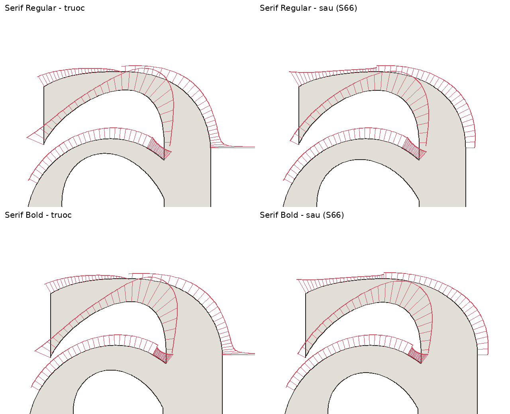
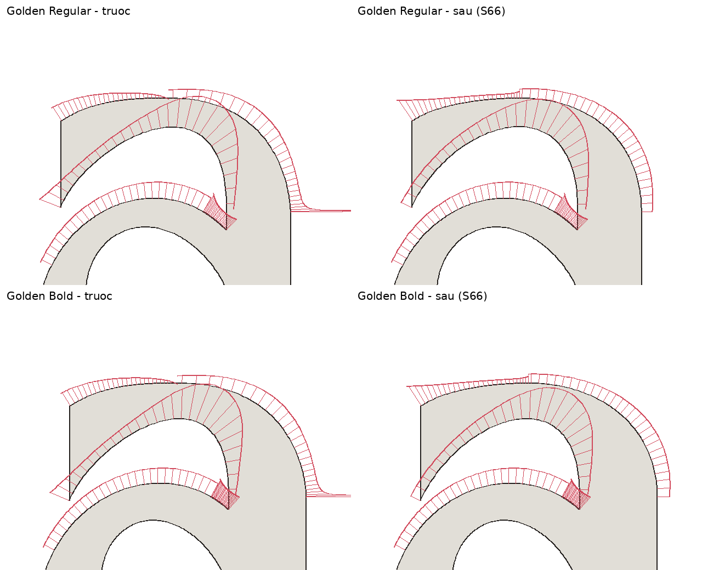

## S67 — file ba trục về họ "AnNam Serif" (21/11, "giữ An Nam Serif thôi")

Bỏ họ riêng "AnNam Serif VF" (S65): `AnNamSerif[XHGT,slnt,wght].ttf`, họ "AnNam Serif", PostScript riêng `AnNamSerifAll-…` (không trùng bản tĩnh). Trục x-Height giữ thang 0–100. Vì cùng họ với mọi file khác, máy dùng file này cài MỘT MÌNH nó (gỡ otf / ttf / variable khác) rồi mở lại Figma — ghi trong README. Version 0.932.

## S68 — lòng móc a thành vòm tròn đều (21/11, "Bụng móc trên thấy vẫn chưa smooth"; "làm trơn luôn m, u và bụng dưới a")

S66 mới làm trơn từng đoạn; lòng móc vẫn LỆCH: bên trái gần như đường chéo thẳng dài, gập gấp ở vai phải (|κ| dồn 13 ở t 0.7). Dựng lại như lòng vòm n:
- lòng móc HAI đoạn, có điểm đỉnh (tiếp tuyến ngang); |κ| tăng đều từ thân lên đỉnh, giảm đều về đầu cắt; khớp G2 ở đỉnh. Đỉnh dời trái 7.6 px bản vẽ (lòng cân hơn); góc mũi đầu cắt giữ 26.7°; lệch S66 ≤ 3 px (≈ 8 u). `A_HOOK_PTS` (src_lower.py).
- weight > Regular (`_a_hook_bold`, lower.py): mọi điểm móc dày xuống B_BAR, thân trong dời trái ½ B_STEM, rồi GIẢI LẠI độ dài hai tay nắm đoạn phải (giữ hướng) cho khớp G2 ở đỉnh, |κ| tăng đều. Sửa lỗi cũ: so khớp điểm móc phải làm trên toạ độ GỐC (trước khi dời thân).
- Font (Regular, |κ| ×1000): lòng móc 2.9 → 9.6 (đỉnh) | 9.3 → 6.7 (thân); cực đại 13.1 → 9.6. Bold 3.0 → 9.3 | 9.7 → 6.7. Golden Regular 2.6 → 10.1 | 10.3 → 5.6.

m, u, bụng dưới a: lược độ cong liền, không gai / bậc; chỉ dao động ≤ 6 % trên cung gần tròn / elip (tự nhiên của elip, không thấy được) — chỗ lược "đứt" là nơi cung gặp thân thẳng / khấc nách (góc chủ ý, như n). Không đổi hình.

QA Serif + Golden: outline 0 lỗi; nét, weight, kern, thanh, tay loe như trước. Version 0.933.

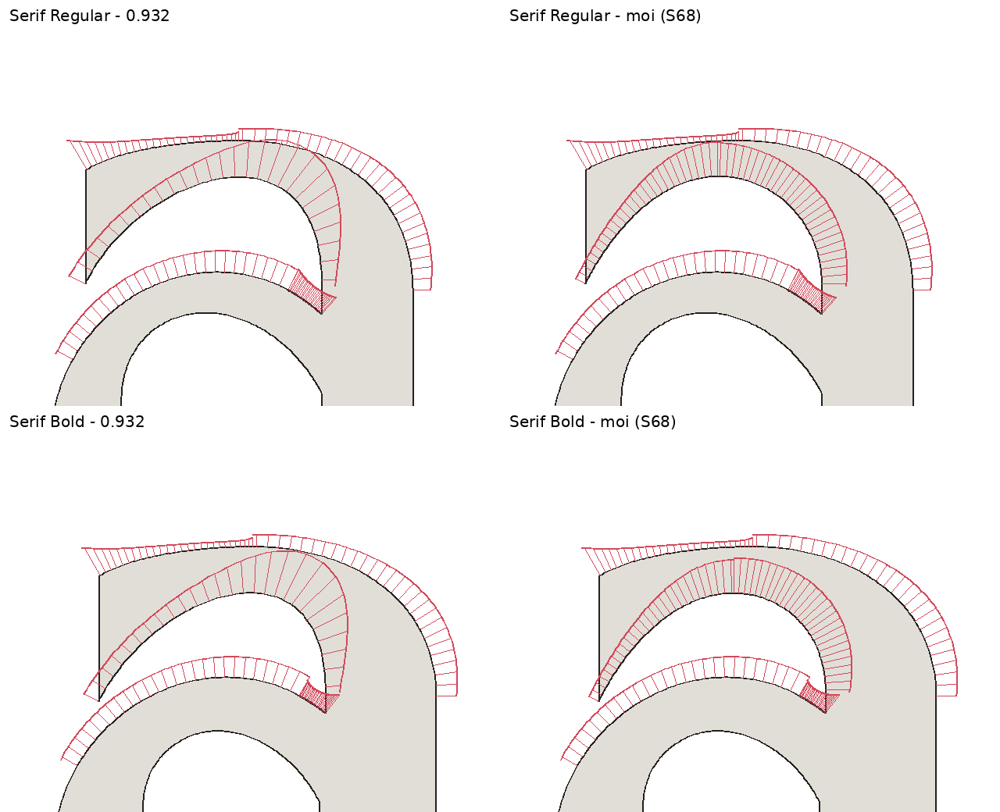
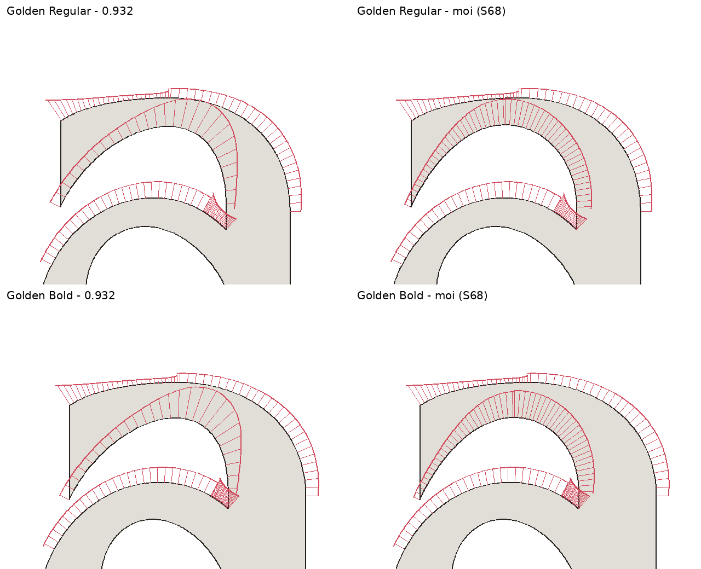
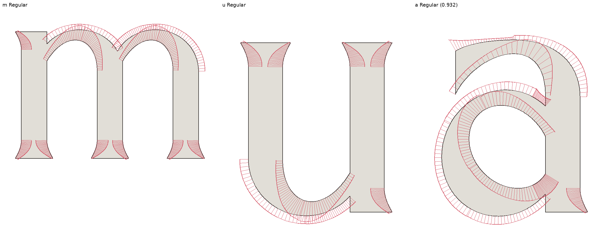

## S69 — dấu ? trơn (21/11, "Bụng cong dấu hỏi hơi gợn")

? dựng từ đầu số 2 của designer + thân Hermite nối ở y 400 (chỉ G1) + uốn hẹp smoothstep → độ cong nhảy ở mối nối (Regular: đỉnh 0 → 8.7, eo 9.3 → 3.4, bụng 5.4 → 9.4). `curve_fair.py`: trên mỗi chuỗi cung nối trơn, điểm neo dời theo pháp tuyến ≤ 2 u, tiếp tuyến xoay ≤ 4°, tay nắm chọn lại — tối thiểu biến thiên độ cong (cả bậc ở mối nối); góc chủ ý và đầu chuỗi giữ. Chạy ở KHÂU XUẤT (export_font, ? ¿) vì bước ghép đoạn trước đó dựng lại cung. Chỉ đổi tay nắm (giữ chặt điểm neo) làm bụng phải nhọn (κ 15) — loại.
Kết quả Regular: đỉnh 4.6 / 5.6, eo 6.7 / 5.8, bụng 5.2 / 4.7 (liền). Đuôi dấu phẩy giữ (designer "khoan k cần giảm").

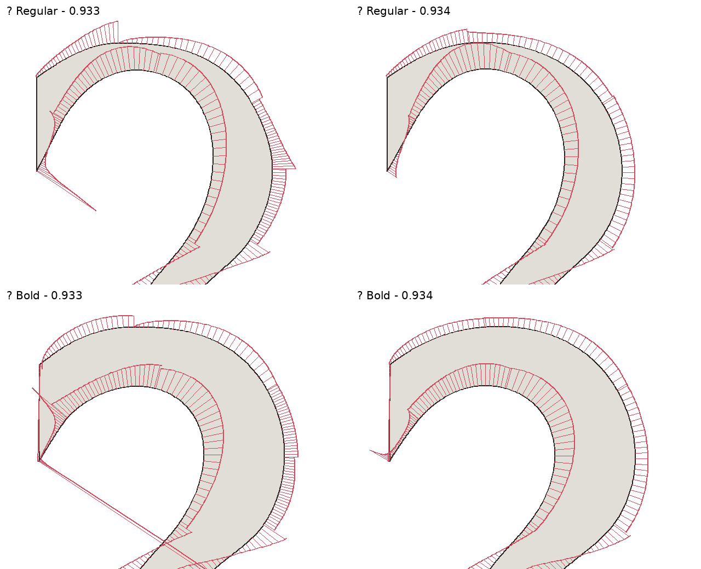

## S70 / S71 — dấu theo chữ hoa: case + calt (21/11, "dấu 2 chấm khi viết hoa bị tuột xuống đáy"; "gõ Shift hay Caps Lock có tự nhảy case không?" → "vậy thêm đi")

- `.case`: `: ;` nâng +112 (hai chấm cách đều tâm chữ hoa 350; ; cùng độ nâng), `- ‐ – —` +20, `« » ‹ ›` +100, `· @` +50 (tâm hộp → 350), `¡ ¿` treo từ 700. Ngoặc / | / \ đã căn 350–355 → giữ. Italic dịch theo góc nghiêng; .case kern như glyph gốc.
- `case`: bật khi ứng dụng bật All Caps / Case-sensitive forms.
- `calt` (bật sẵn ở Word / Figma / trình duyệt): tự đổi theo ngữ cảnh — sau chữ hoa / số, trước chữ hoa / số, giữa hai cụm hoa cách khoảng trắng; dấu sau dấu đã nâng nâng theo. Thử 14 chuỗi (HÀ NỘI: 10:30 «VIỆT NAM» HÀ NỘI — ĐÀ NẴNG NAM:» A-Z ¿QUÉ? EMAIL@DIZAI / bản chữ thường giữ) — đúng ở Serif, Golden, variable.

Version 0.934.

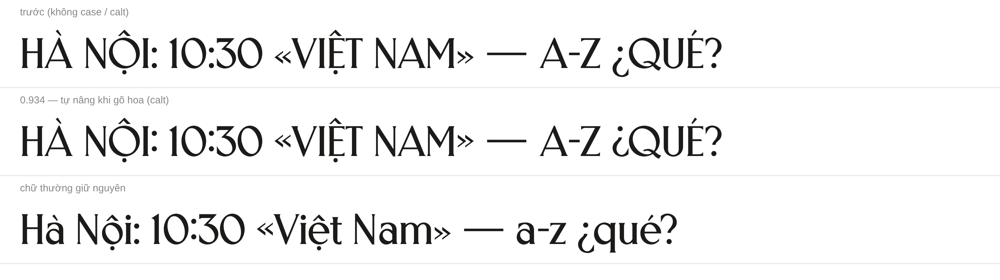

## S72 — Golden nét mảnh 34 / 42 (22/11, "làm mỏng các nét mỏng của golden đồng loạt … khi bold lên thì nét mỏng tăng ít thôi"; "nét mỏng đứng N dày hơn nét mỏng của O" → "đưa về mỏng như nét đứng"; "đồng bộ hết cho các ký tự khác")

- RING_T = ARCH_T = 34 / 42 (trước 42 / 56.5 = Serif): Regular → Bold nét mảnh chỉ tăng 8 (Serif 14.5). Nét ngang × BAR_K 0.88 = 29.9 / 37.
- CAPS_AS_SERIF = False: chữ hoa Golden theo cùng chuẩn (bỏ luật 20/11 "hoa dày y chang Serif").
- Nhận diện nét mảnh theo chuẩn Serif (SER_T 42 / 56.5): ngưỡng 1.6 × 34 bỏ sót bụng B D P R, vòm n u.
- G8 đo thử dọc đoạn khi tia giữa đoạn không gặp mép song song (V v w y Bold: 46–47 → 42).
- Đo (qa_thin.py, mới): N đứng 34.0 / 42.0, O chỗ mỏng nhất 33.5 / 42, B D P R ngang 33.8 / 29–30, V chéo 33.5 / 42. Còn: A Regular 37; số 4 7 chưa qua luật (chờ designer).

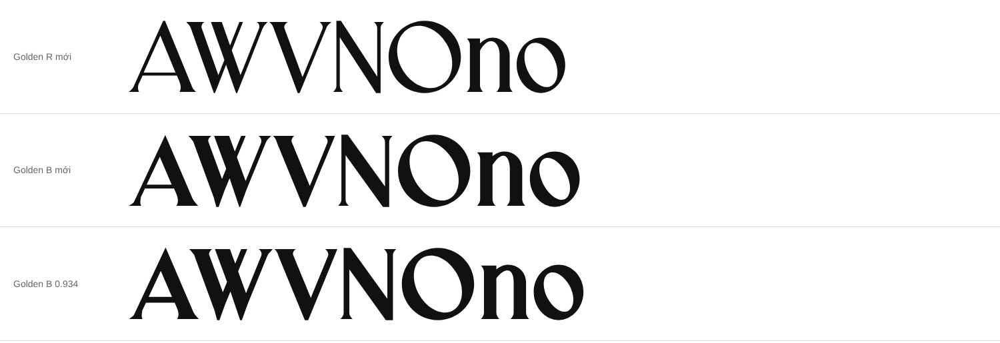

## S73 / S74 — N theo bản vẽ mới, dấu Ê ở tâm (23/11)

- N (Figma 2272:822, "chỉ tham khảo glyph. Độ dày giữ như hiện tại. chỉ đổi độ dày thanh chéo N cho dày hơn một chút"): đỉnh trái / chân phải phẳng trên đường kẻ (bỏ nhọn vượt 711 / −11), loe đầu thân trái + chân thân phải (đối xứng dọc loe sẵn có), thanh chéo 99.7 → 108 (Regular), 136.8 → 148 (Bold), M / SB nội suy 121 / 134. `ref/navw.py`, nguồn cũ `designer_*_preNAVW.json`.
- A V W: thử đỉnh / đáy phẳng + vạt loe rồi bỏ (designer "bỏ móc trên A để A, V, W về phiên bản cũ") — giữ như 0.934, độ dày đồng bộ theo luật chung. v w y k thường dựng từ V W bản trước (`lower/caps_lc_src.json`).
- Dấu trên E (É È … Ê Ế Ề Ể Ễ Ệ) đặt ở tâm hộp (trước 0.44 bề ngang, lệch trái 22 u — designer "dấu ô bị lệch trên chữ Ê").
- Đo Serif: nét chéo dày N 108 / 121 / 134 / 148, A 99.6 → 137, V 101 → 140, W 102 → 141 (đều theo weight); nét mảnh 42 / 56.5. Golden: nét mảnh 34 / 42, số 4 7 vào G8 (còn thanh 4 Regular 37 ≠ 30, A chéo Regular 37 ≠ 34).
- Version 0.935.

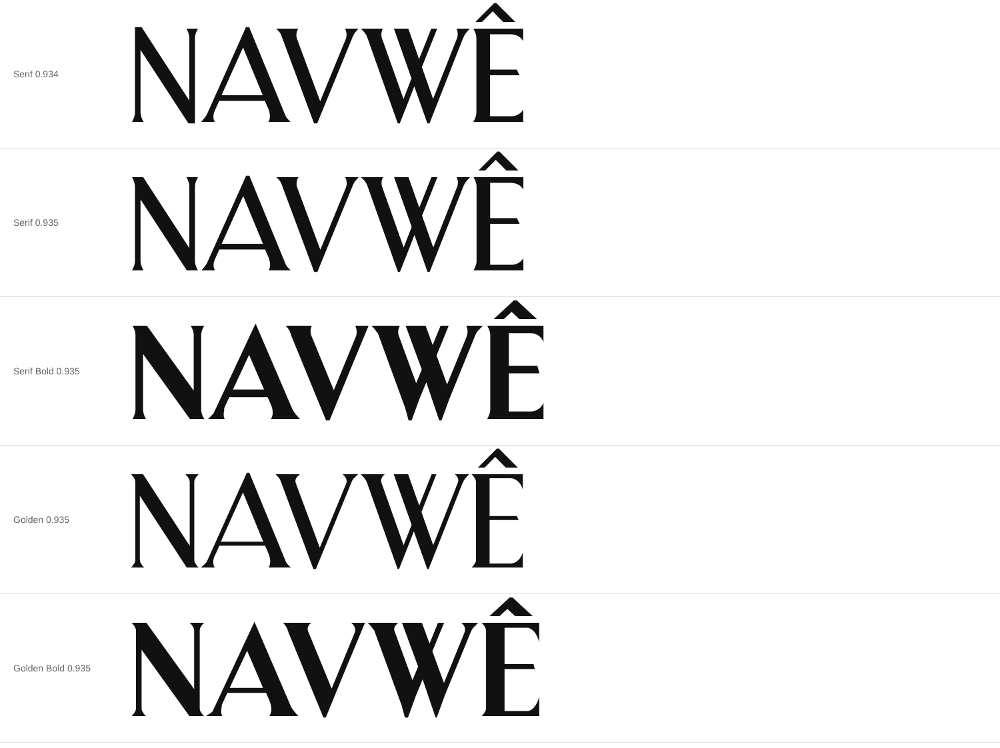

## S75 — G16 đỉnh A Golden cắt như Serif (23/11, "đầu A golden bị nhọn chứ không phải cắt như Serif")

Làm mảnh nét trái A (42 → 34) dời mép ngoài song song → mặt cắt đỉnh hẹp (Regular 23 → 19 u; Bold 5.4 u → hai mép chéo nhau, nhọn). G16 (`apex_keep`, A Æ): mép NGOÀI nét mảnh về đúng chỗ AnNam Serif (mặt cắt 23.3 / 5.4 u), mép TRONG (lòng + chân dưới thanh) dời thêm cùng lượng → nét mảnh đều đúng chuẩn (Bold 42 suốt nét; Regular 34 trên thanh, 36.5 chân như trước); đỉnh trong lòng = giao mép mới với mép trong nét dày. Lòng A rộng ra ~4 u.

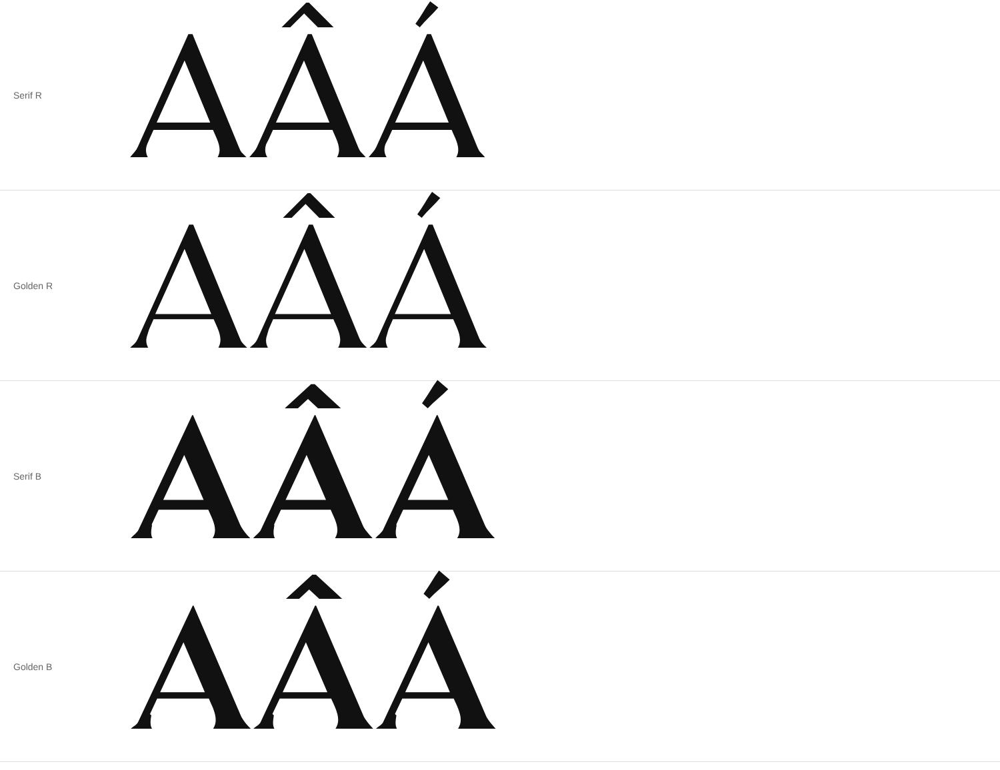
