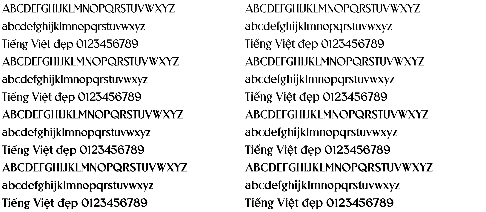
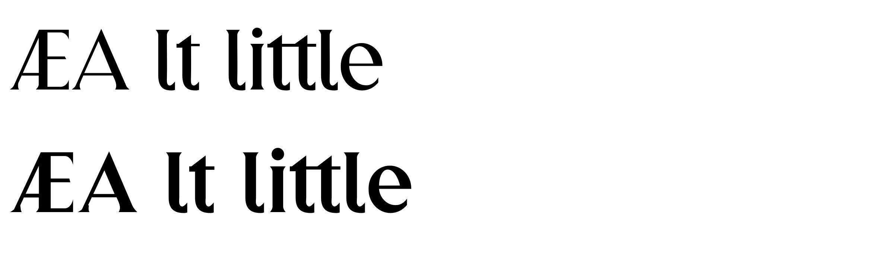

# An Nam Golden

Họ chữ phát triển từ AnNam Serif (designer 19–20/11). Dựng bằng luật trên outline Regular + Bold của AnNam Serif
(`tools/construct/golden/golden.py`), Medium / SemiBold nội suy; chạy `bash tools/construct/golden/run.sh` sau pipeline AnNam Serif.
Font: `fonts/golden/` (OTF, TTF, variable, woff2), tên họ "AnNam Golden", PostScript `AnNamGolden-*`.

| Luật | Nội dung |
|---|---|
| G1 | x-height 495 → 535 (chữ thường, chữ ghép, dấu tổ hợp); bề ngang giữ; đầu thân b d h k l þ giữ 699 (chỉ đoạn thân thẳng co), đ thanh giữ dày, f móc giữ hình (cao thêm 20), ß phần trên co; dấu, chấm dời lên 40.7 |
| G5 | đầu t (và t trong ft tf tt) vát: mép phải thân thẳng lên đỉnh cao 1.03 × bề ngang thân trên mặt thanh, cạnh vát xuống mặt thanh cách mép trái thân 0.625 × phần thanh thò trái (hình phác designer) |
| G4 | v x y (ý ỳ ỷ ỹ ỵ ÿ) rộng × 1.08 quanh tâm, nét thu lại × 1/1.08 (giữ bề dày), dấu giữ hình |
| G3 | loe (chân, đỉnh thân, chéo): rộng × 1.3 theo đường chân, cao × 0.85 — vuốt nhọn; điểm nối thân trượt trên đường thân (liền tiếp tuyến) |
| G2 | nét mảnh (thanh ngang, chéo mảnh, vòng mảnh, khớp) chữ hoa + thường còn ~80 %: mép dời theo pháp tuyến 0.1 × bề dày; đoạn thẳng đo ở giữa đoạn (thanh không vát); cung dài chia đôi để đặt luật tại chỗ mảnh nhất; thân dày, dấu giữ |

Số đo (Regular, trục giữa): thanh H 40 → 32, N đứng 48 → 36, O mảnh 34 → 27, S mảnh 38 → 29; thân giữ 104.
Ảnh: `docs/img/golden-v1.png`.

## S50 — luật nét mảnh làm lại (20/11)

- Đoạn thẳng: dời song song cả đoạn; góc cung–thẳng chỉ theo phía đoạn thẳng; đoạn ngắn nối tiếp nét thẳng (≤ 20°) dời cùng nét (W giữ góc nối gốc).
- G7 s S: lòng trên / dưới kéo dãn đứng affine từ điểm chân chuỗi (không đẩy từng điểm neo → hết gãy góc).
- G10 (mới) mọi nét mảnh cong còn lại — b d p q a g c C G U J, vòm n m h u, B D P R: chuỗi cung lõm của mép lòng kéo dãn đứng, dốc tuyến tính từ giữa chuỗi (affine, tay nắm cùng phép); góc trên thân đứng trượt theo thân (cả tay nắm kề), góc khác đứng yên. δ = min((dày − chuẩn)/dốc) đo theo pháp tuyến → không điểm nào mỏng hơn chuẩn. Lòng kín: hai chiều (làm dày được); lòng hở: chỉ kéo mảnh (đầu nét / vai mảnh là chủ ý).
- Bỏ đoạn < 2 u ở cả hai master (nách K).
- Đo: Golden 32 / 44 ± 2 (trừ B D R ~40 / 52–55 — mép thẳng trên đường kẻ); AnNam Serif 42 / 62 (n m h u C G 37–38 Regular theo bản vẽ, lòng hở không làm dày).

## S51 — thanh ngang không dốc (designer 20/11 "nét trong của Z bị dốc", "kiểm tra z luôn")

Nguyên nhân (cả AnNam Serif lẫn Golden): (1) góc cung–thẳng (đầu thanh nối loe) giải theo tiếp tuyến cung → gần như đứng yên trong khi đầu nối thân dời; (2) khi làm DÀY (hệ số > 1) điều kiện chặn độ dời dùng max(da, db) = 0 → góc nối thân bị bỏ; (3) góc thẳng–thẳng trên đường kẻ (đỉnh chéo M W Y K) bị bỏ qua thay vì trượt dọc đường kẻ; (4) mẩu nối 2.5 u ở nách K không có tiếp tuyến.
Sửa: góc cung–thẳng dời theo pháp tuyến đoạn thẳng; chặn theo |da|, |db|; góc thẳng–thẳng trên đường kẻ trượt dọc đường kẻ; bỏ mẩu < 3 u trước mọi luật.
QA mới `tools/construct/qa_lines.py` (chạy cuối pipeline, so với v0.918): đoạn ngang / đứng giữ hướng (≤ 0.3°), mép trên đường kẻ còn trên đường kẻ, AnNam Serif mọi đoạn giữ hướng (≤ 0.5° + sai số làm tròn). Kết quả: Golden 0 · AnNam Serif 1 (Ë Bold — chủ ý: Ë = E + dấu thay cho Ë vẽ riêng ở v0.918).

## S52 — thanh T và đồng bộ mọi thanh (designer 20/11 "thanh ngang của T sao lại dày hơn của các chữ khác")

- G11 thanh T: thanh là contour riêng chồng thân, mép dưới là hai cung loe chạy vào thân → điểm nối cung–thân (tiếp tuyến ngang) dời đứng tới đúng chuẩn; đầu nhọn loe đứng yên.
- G8 tuyệt đối: mỗi đoạn thẳng nét mảnh (0.5–1.6 × chuẩn) tự về ĐÚNG chuẩn, đo riêng giữa đoạn (bỏ hệ số chung cả chữ — làm thanh P mảnh quá). Áp mọi chữ gốc, gồm thanh e f t.
- QA mới `tools/construct/qa_bars.py`: độ dày thanh ngang mọi chữ so chuẩn (lệch > 3 u = lỗi). Kết quả: AnNam Serif 42 / 62 ± 1, Golden 32 / 44 ± 1, 0 lỗi.

## S54 — weight AnNam Serif đồng bộ theo Golden (designer 20/11 "đồng bộ weight của serif giống với golden")

Golden giữ tương phản cố định qua các weight (nét mảnh / thân = 32/104 = 44/140 ≈ 0.31). AnNam Serif trước đây 42 → 62 (0.40 → 0.44: Bold mất tương phản, nặng). Nay nét mảnh AnNam Serif tăng đúng theo thân: Regular 42, Bold 56.5 (= 42 × 140/104), Medium / SemiBold nội suy (46.8 / 51.7) — tương phản 0.40 cố định.
Kèm: đoạn thẳng gần thẳng hàng (≤ 6°) với đoạn kề dài hơn (mép nét bị chia bởi khớp / mẩu nối, vd. chéo mảnh W, tay K) dời cùng nét đó.
QA: thanh ngang AnNam Serif 42–43 / 56–58, Golden 32–33 / 41–45, 0 lỗi; đoạn thẳng đổi hướng Golden 0, AnNam Serif 2 (x Regular 0.52°, K Bold 0.67° — ≤ 3 u trên cả đoạn); 0 lỗi outline; đơn điệu 4 weight AnNam Serif 0 lỗi.

## S55–S56 — nét ngang Golden 0.88, loe chữ hoa dài hơn, tay loe bằng nhau (20/11)

- Golden: nét NGANG = 0.88 × nét mảnh (designer chọn k 0.88 — "nét ngang F L T E Z dầy hơn nét còn lại": hiệu chỉnh quang học, nét ngang trông dày hơn nét cong cùng số đo). Regular 28 / Bold 39.
- Golden: loe chân chữ hoa rộng × 1.45 (chữ thường giữ × 1.3) — "đuôi chân loe dài thêm ra thêm xíu".
- G13 tay loe đầu thanh (mép cắt đứng ở đầu tay E F L T Z Æ Œ) dài BẰNG NHAU: AnNam Serif 94 / 122 (bản vẽ gốc), Golden 114 / 148. Trước đó T và E lệch tới 34 u (Bold).
- Mép thẳng trên đường kẻ: dung sai 2.5 u (phần E của Œ nối từ điểm vượt O, xiên 2 u — trước bị dời lên 4 u, rời chân / đỉnh).
- QA mới `qa_arms.py` (độ dài tay loe bằng nhau). Kết quả: cả hai họ chênh 0.0 ở 4 weight; thanh ngang 0 lỗi; đoạn thẳng Golden 0.
- Version 0.920.

## S57 — đỉnh A của Æ, chân l Golden (20/11)

- Æ: đoạn ngắn ở đỉnh trong A (thẳng hàng với mép trong nét chéo, 65.9°) bị xoay thành 14.5° (Bold) → gãy. Nguyên nhân: hướng ra ngoài của đoạn thẳng thử ở điểm 3 u sát góc — góc hẹp nên điểm thử lọt vào thân E bên cạnh, pháp tuyến đảo, điểm nối trượt XUỐNG 28 u thay vì lên. Sửa: đoạn thẳng thử ở GIỮA đoạn. Nay 65.2° / 64.3°.
- G14 (chỉ Golden, designer "dùng chân chữ t cho chân chữ l"): l = loe đỉnh của l + thân dưới và móc chân của t (cùng bề thân, dời ngang trùng mép trái).
- Rà từng cờ đổi chiều cong: A e Æ ø — cung phẳng, không gợn; W — gợn ~1 u ở cung loe đầu chéo mảnh (chỉ thấy khi phóng 30×). Version 0.921.

